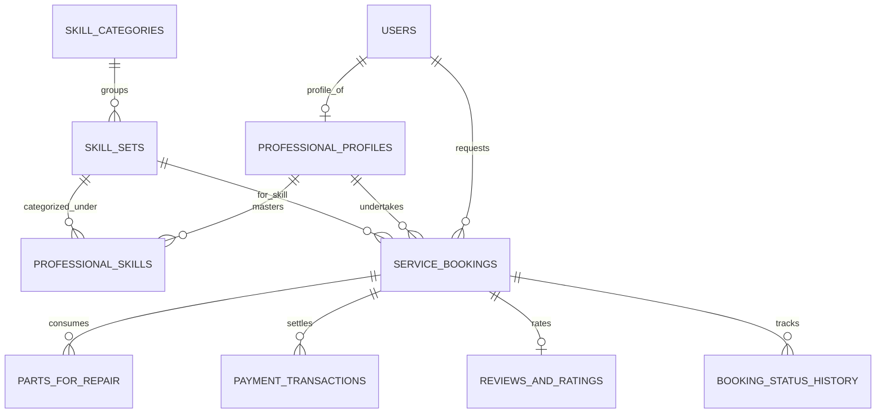

# SkillCommerce Database Architecture & Implementation Guide

> **Document Type:** Consolidated Single Source of Truth for Database Design & Polyglot Persistence  
> **Platform:** SkillCommerce / Dokkho Lok Khuji (দক্ষ লোক খুঁজি)  
> **Datastores:** SQL Server 2022, MongoDB, Redis 7.2, Elasticsearch  
> **Status:** Canonical & Deduplicated Specification  

---

## 1. Polyglot Storage Strategy & Store Ownership

SkillCommerce employs a polyglot persistence architecture. Each storage engine has a strictly defined, non-overlapping boundary of authority:

```text
┌────────────────────────────────────────────────────────────────────────┐
│                        POLYGLOT DATA PLATFORM                          │
├─────────────────────┬───────────────────┬───────────────┬──────────────┤
│   SQL SERVER 2022   │     MONGODB       │   REDIS 7.2   │ELASTICSEARCH │
│  (ACID Transactional│ (Unstructured Doc │  (In-Memory   │ (Full-Text & │
│     Master Core)    │     Catalog)      │ Cache & Lock) │ Vector Search│
├─────────────────────┼───────────────────┼───────────────┼──────────────┤
│ • Users & Identity  │ • Provider Rich   │ • Guest/User  │ • Bilingual  │
│ • 3NF Skill Taxonomy│   Portfolios      │   Shopping    │   Bangla/EN  │
│ • Service Bookings  │ • Work Sample     │   Carts       │   Catalog    │
│ • Replacement Parts │   Galleries       │ • Distributed │ • Phonetic & │
│ • Payment Ledger    │ • Dynamic Tool &  │   Mutex Locks │   Fuzzy Trade│
│ • Spatial Geodata   │   Equipment Specs │ • Rate Limits │   Matching   │
│ • Audit & AI Logs   │ • Review Media    │ • Tech Geo    │ • Vector Dims│
└─────────────────────┴───────────────────┴───────────────┴──────────────┘
```

---

## 2. Unified Database Workspace Structure

All database scripts, migrations, mappings, and configuration files reside in a standardized folder structure:

```text
DataBase/
├── docker-compose.yml             # Local multi-container environment (SQL Server, MongoDB, Redis, ES)
├── README.md                      # Connection strings and local initialization steps
│
├── relational/                    # SQL Server 2022 (ACID Transactional Master)
│   ├── migrations/                # Versioned EF Core DDL migrations
│   │   ├── 001_initial_identity_and_taxonomy.sql
│   │   ├── 002_create_bookings_and_parts.sql
│   │   └── 003_create_financial_ledger.sql
│   └── seeds/                     # Development & staging seed data
│       └── dev_seed.sql
│
├── document/                      # MongoDB (Provider Portfolios & Dynamic Metadata)
│   ├── collections/
│   │   ├── portfolios.validation.json  # Strict JSON Schema validation rules
│   │   └── reviews_media.validation.json
│   ├── indexes/
│   │   └── create_indexes.js           # Compound & geospatial 2dsphere indexes
│   └── seeds/
│       └── initial_portfolios.json
│
├── search/                        # Elasticsearch (Full-Text & Vector Search)
│   ├── mappings/
│   │   └── service_catalog_mapping.json # Analyzers, tokenizers, dense_vector (768 dims)
│   └── pipelines/
│       └── bilingual_ingest_pipeline.json
│
└── cache/                         # Redis 7.2 (Carts, Rate Limits, Locks)
    ├── key-registry.md            # Canonical registry of keys, namespaces, and TTLs
    └── scripts/                   # Atomic Lua concurrency scripts
        ├── reserve_stock.lua      # Atomic stock reservation during checkout
        ├── release_stock.lua      # Release expired or cancelled stock
        └── rate_limiter.lua       # Sliding-window rate limiting script
```

---

## 3. Relational Schema & Third Normal Form (3NF) Architecture

The relational core conforms strictly to **Third Normal Form (3NF)**:
- **1NF Compliance:** Atomic scalar attributes; repeating groups (skills, itemized replacement parts) are decomposed into normalized child tables.
- **2NF Compliance:** All non-key attributes fully functionally depend on the complete primary key.
- **3NF Compliance:** Non-key attributes depend solely on the primary key, eliminating transitive dependencies. `SkillCategories` exists independently from `SkillSets`, ensuring updates to category metadata do not cause anomalies in skill assignments.

### 3.1 Entity-Relationship Model (Mermaid ERD)


### 3.2 Canonical Relational DDL Specifications

```sql
-- 1. Users Core Table (ASP.NET Identity Compatible)
CREATE TABLE [dbo].[Users] (
    [Id] NVARCHAR(450) NOT NULL PRIMARY KEY,
    [FullName] NVARCHAR(150) NOT NULL,
    [Email] NVARCHAR(256) NOT NULL UNIQUE,
    [PhoneNumber] NVARCHAR(20) NOT NULL UNIQUE,
    [PasswordHash] NVARCHAR(MAX) NOT NULL,
    [UserRole] NVARCHAR(30) NOT NULL, -- 'Customer', 'Provider', 'Admin'
    [CreatedAtUtc] DATETIME2(7) NOT NULL DEFAULT SYSUTCDATETIME()
);

-- 2. Professional Profiles Table
CREATE TABLE [dbo].[ProfessionalProfiles] (
    [Id] UNIQUEIDENTIFIER NOT NULL PRIMARY KEY DEFAULT NEWSEQUENTIALID(),
    [UserId] NVARCHAR(450) NOT NULL UNIQUE FOREIGN KEY REFERENCES [dbo].[Users]([Id]),
    [Bio] NVARCHAR(1000) NULL,
    [NidNumber] NVARCHAR(30) NOT NULL UNIQUE,
    [NidCardFrontUrl] NVARCHAR(500) NULL,
    [NidCardBackUrl] NVARCHAR(500) NULL,
    [IsVerified] BIT NOT NULL DEFAULT 0,
    [IsAvailable] BIT NOT NULL DEFAULT 1,
    [StandardHourlyRate] DECIMAL(18,2) NOT NULL DEFAULT 0.00,
    [ServiceRadiusKm] INT NOT NULL DEFAULT 5,
    [Location] GEOGRAPHY NOT NULL, -- SRID 4326 Point(Lon, Lat)
    [PrimaryArea] NVARCHAR(100) NOT NULL,
    [CreatedAtUtc] DATETIME2(7) NOT NULL DEFAULT SYSUTCDATETIME()
);

-- Spatial index on provider geographic location
CREATE SPATIAL INDEX [SPX_ProfessionalProfiles_Location] 
ON [dbo].[ProfessionalProfiles]([Location]);

-- 3. Skill Taxonomy Tables
CREATE TABLE [dbo].[SkillCategories] (
    [Id] INT IDENTITY(1,1) PRIMARY KEY,
    [NameEnglish] NVARCHAR(100) NOT NULL UNIQUE,
    [NameBengali] NVARCHAR(100) NOT NULL,
    [Slug] NVARCHAR(100) NOT NULL UNIQUE,
    [AvatarFileName] NVARCHAR(200) NOT NULL,
    [IsActive] BIT NOT NULL DEFAULT 1
);

CREATE TABLE [dbo].[SkillSets] (
    [Id] INT IDENTITY(1,1) PRIMARY KEY,
    [CategoryId] INT NOT NULL FOREIGN KEY REFERENCES [dbo].[SkillCategories]([Id]),
    [SkillNameEnglish] NVARCHAR(150) NOT NULL,
    [SkillNameBengali] NVARCHAR(150) NOT NULL,
    [DefaultLaborCost] DECIMAL(18,2) NOT NULL DEFAULT 0.00,
    [EstimatedDurationMinutes] INT NOT NULL DEFAULT 60
);

CREATE TABLE [dbo].[ProfessionalSkills] (
    [ProfileId] UNIQUEIDENTIFIER NOT NULL FOREIGN KEY REFERENCES [dbo].[ProfessionalProfiles]([Id]),
    [SkillSetId] INT NOT NULL FOREIGN KEY REFERENCES [dbo].[SkillSets]([Id]),
    [YearsOfExperience] INT NOT NULL DEFAULT 1,
    PRIMARY KEY ([ProfileId], [SkillSetId])
);

-- 4. Bookings & Lifecycle Table
CREATE TABLE [dbo].[ServiceBookings] (
    [Id] UNIQUEIDENTIFIER NOT NULL PRIMARY KEY DEFAULT NEWSEQUENTIALID(),
    [TrackingCode] NVARCHAR(12) NOT NULL UNIQUE,
    [CustomerId] NVARCHAR(450) NOT NULL FOREIGN KEY REFERENCES [dbo].[Users]([Id]),
    [ProviderProfileId] UNIQUEIDENTIFIER NULL FOREIGN KEY REFERENCES [dbo].[ProfessionalProfiles]([Id]),
    [SkillSetId] INT NOT NULL FOREIGN KEY REFERENCES [dbo].[SkillSets]([Id]),
    [CurrentStatus] NVARCHAR(30) NOT NULL, -- 'Draft', 'Pending', 'Accepted', 'OnTheWay', 'InProgress', 'Completed', 'Cancelled'
    [IsUrgent] BIT NOT NULL DEFAULT 0,
    [ScheduledForUtc] DATETIME2(7) NOT NULL,
    [Location] GEOGRAPHY NOT NULL,
    [ServiceAddress] NVARCHAR(500) NOT NULL,
    [AreaName] NVARCHAR(100) NOT NULL,
    [ProblemDescription] NVARCHAR(MAX) NOT NULL,
    -- Pricing Snapshot
    [LaborCost] DECIMAL(18,2) NOT NULL DEFAULT 0.00,
    [UrgencyFee] DECIMAL(18,2) NOT NULL DEFAULT 0.00,
    [PartsTotal] DECIMAL(18,2) NOT NULL DEFAULT 0.00,
    [CommissionRateApplied] DECIMAL(5,4) NOT NULL DEFAULT 0.1000,
    [PlatformCommissionFee] DECIMAL(18,2) NOT NULL DEFAULT 0.00,
    [TotalCharge] DECIMAL(18,2) NOT NULL DEFAULT 0.00,
    [ProviderNetEarnings] DECIMAL(18,2) NOT NULL DEFAULT 0.00,
    -- Lifecycle Timestamps
    [AcceptedAtUtc] DATETIME2(7) NULL,
    [DispatchedAtUtc] DATETIME2(7) NULL,
    [StartedAtUtc] DATETIME2(7) NULL,
    [CompletedAtUtc] DATETIME2(7) NULL,
    [CancelledAtUtc] DATETIME2(7) NULL,
    [CancellationReason] NVARCHAR(500) NULL,
    [CreatedAtUtc] DATETIME2(7) NOT NULL DEFAULT SYSUTCDATETIME()
);

-- 5. Replacement Hardware Parts Table
CREATE TABLE [dbo].[PartsForRepair] (
    [Id] UNIQUEIDENTIFIER NOT NULL PRIMARY KEY DEFAULT NEWSEQUENTIALID(),
    [BookingId] UNIQUEIDENTIFIER NOT NULL FOREIGN KEY REFERENCES [dbo].[ServiceBookings]([Id]),
    [PartName] NVARCHAR(200) NOT NULL,
    [UnitPrice] DECIMAL(18,2) NOT NULL,
    [Quantity] INT NOT NULL DEFAULT 1,
    [ReceiptPhotoUrl] NVARCHAR(500) NULL,
    [CreatedAtUtc] DATETIME2(7) NOT NULL DEFAULT SYSUTCDATETIME()
);

-- 6. Financial Settlement & Transactions
CREATE TABLE [dbo].[PaymentTransactions] (
    [Id] UNIQUEIDENTIFIER NOT NULL PRIMARY KEY DEFAULT NEWSEQUENTIALID(),
    [BookingId] UNIQUEIDENTIFIER NOT NULL FOREIGN KEY REFERENCES [dbo].[ServiceBookings]([Id]),
    [Amount] DECIMAL(18,2) NOT NULL,
    [PaymentMethod] NVARCHAR(30) NOT NULL, -- 'Cash', 'bKash', 'Nagad', 'Card'
    [TransactionReference] NVARCHAR(100) NOT NULL,
    [SettledAtUtc] DATETIME2(7) NOT NULL DEFAULT SYSUTCDATETIME()
);
```

---

## 4. Redis Cache Registry & Operational Concurrency

- **Engine:** Redis 7.2 (In-Memory Data Store)
- **Eviction Policy:** `volatile-lru` (Evict expired keys under high memory usage)
- **Memory Allocation Cap:** 512MB

### 4.1 Redis Key Namespaces & Operational TTLs
| Namespace | Key Pattern | Data Type | TTL | Purpose & Invalidation Strategy |
| :--- | :--- | :--- | :--- | :--- |
| **Guest Carts** | `cart:guest:{sessionId}` | Hash | 7 Days | Stores unauthenticated items; merged into user cart upon login. |
| **User Carts** | `cart:user:{userId}` | Hash | 30 Days | Cross-device shopping cart persistence. |
| **Stock Reservations**| `stock:res:{sku}:{orderId}` | String | 15 Mins | Holds hardware stock during checkout; auto-expires if payment fails. |
| **Distributed Locks** | `lock:sku:{sku}` | String | 5 Secs | Mutex lock preventing checkout race conditions (`SET NX EX 5`). |
| **User Sessions** | `session:auth:{userId}:{tokenId}`| Hash | 7 Days | Active JWT session cache; deleted on logout. |
| **Token Blacklist** | `token:revoked:{jti}` | String | Token Exp | Stores invalidated JWT IDs until expiration. |
| **API Rate Limits** | `ratelimit:{ip}:{action}` | Sorted Set | 60 Secs | Sliding-window limiter on sensitive dispatches. |
| **AI Feature Limits** | `ratelimit:{userId}:ai:{feature}` | Sorted Set | 60 Secs | Throttles AI calls to stay within free-tier caps. |
| **Technician Geo** | `geo:providers:active` | GeoSet | 24 Hours | Real-time coordinates of active providers updated via SignalR. |
| **Category Cache** | `cache:categories:tree` | String | 1 Hour | High-frequency navigation read cache. |

### 4.2 Atomic Lua Concurrency Scripts
All checkout stock reservation operations must execute through atomic Lua scripts to prevent overselling:
- `reserve_stock.lua`: Evaluates current stock and decrements available count in a single atomic round-trip.
- `release_stock.lua`: Re-credits stock back to the available pool when an order cancels or expires.
- `rate_limiter.lua`: Implements sliding-window rate limit checks.

---

## 5. MongoDB Document Collections (Unstructured Metadata)

MongoDB stores fluid, schema-less media and portfolio items:
- **`portfolios` Collection:** Holds technician project galleries, tools possessed, and case histories with strict JSON schema validation for image URLs, dimensions, and timestamps.
- **Index Requirements:**
  ```javascript
  db.portfolios.createIndex({ "providerProfileId": 1 }, { unique: true });
  db.portfolios.createIndex({ "skills": 1 });
  ```

---

## 6. Elasticsearch Full-Text & Vector Search

Elasticsearch indexes the catalog for instant bilingual discovery:
- **Analyzers:** Custom analyzers configured for Bengali stemmers and English lowercase filters.
- **Vector Dimensions:** `dense_vector` is mapped to **768 dimensions** matching Google Gemini `text-embedding-004`.
- **Geospatial Queries:** Configured with `geo_point` field types for distance scoring and bounding-box queries.

---

## 7. Transactional Outbox Pattern & Data Integrity

To guarantee eventual consistency across SQL Server, Redis, and Elasticsearch without distributed 2PC transactions:
1. Every business change writes its domain event to an `OutboxEvents` table within the same SQL transaction.
2. A background worker (Hangfire) polls `OutboxEvents`, publishes to SignalR hubs, syncs changes to Elasticsearch, and flushes related Redis caches.
3. Once published, the outbox record is marked `ProcessedAtUtc`.
