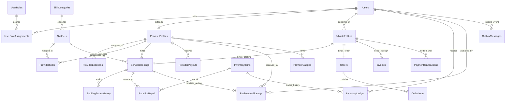
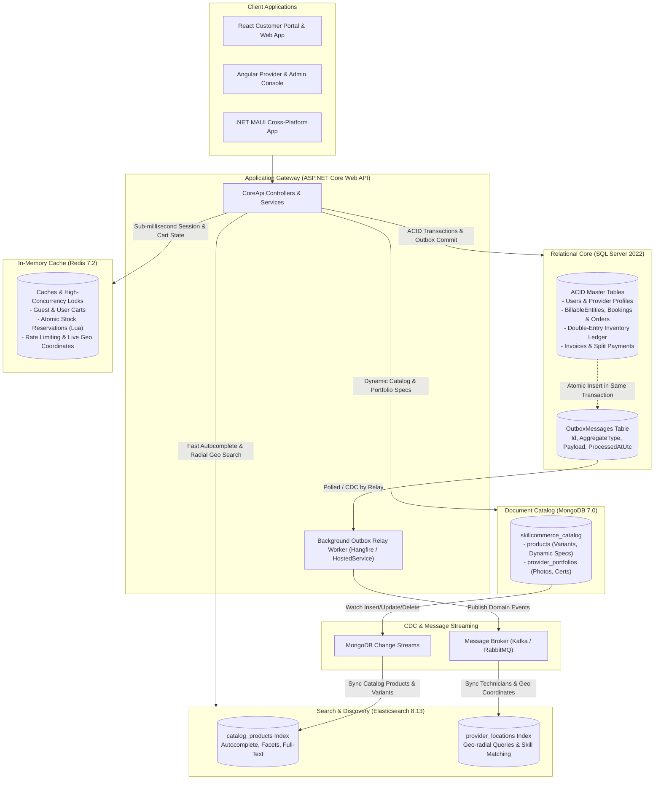

# SkillCommerce / Dokkho Lok Khuji (দক্ষ লোক খুঁজি)
## Database Architecture & Entity Relationship Diagrams

---

## 1. Relational Core Entity Relationship Diagram (SQL Server 3NF)

---

## 2. Dual-Stream Search Sync & Event Streaming Architecture

---

## 3. Polyglot Entity Reference Mapping & Contract Matrix

| Relational Table | Relational Column | Target Store | Target Collection / Key | Reference Type | Architecture Purpose |
| :--- | :--- | :--- | :--- | :--- | :--- |
| **`BillableEntities`** | `BillableEntityId` | **SQL Server** | `Orders` / `ServiceBookings` | 1-to-1 Shared Contract | Eliminates nullable foreign keys in Invoices & PaymentTransactions. |
| **`PartsForRepair`** | `InventoryItemId` | **SQL Server** | `InventoryItems.InventoryItemId` | 1-to-N FK | Deducts physical inventory upon repair completion and logs debit into ledger. |
| **`PartsForRepair`** | `SnapshotData` | **JSON Column** | *In-table JSON* | Immutable Snapshot | Freezes exact part specifications and historical unit price at moment of job. |
| **`OrderItems`** | `MongoProductId` | **MongoDB** | `products._id` | Immutable Logical ID | Preserves decoupled link to rich product attributes without cross-store FKs. |
| **`OrderItems`** | `SnapshotData` | **JSON Column** | *In-table JSON* | Immutable Snapshot | Preserves frozen price, SKU, title, and tax at exact second of checkout. |
| **`ProviderProfiles`**| `ProfileId` | **MongoDB** | `provider_portfolios.providerId`| Logical UUID | Binds technician profile to rich certifications, before/after media, and awards. |
| **`Orders` / `Cart`** | `Sku` | **Redis** | `stock:available:{sku}` | String Counter | Atomic stock verification and leasehold reservation before relational commit. |
| **`ProviderLocations`**| `Latitude`, `Longitude`| **Elasticsearch**| `provider_locations.location` | `geo_point` | Enables fast Haversine radial queries (e.g., locate technicians within 5km radius). |
| **`OutboxMessages`** | `AggregateId` | **Message Broker**| `Kafka Topic / Queue` | Event Message | Guarantees at-least-once delivery for asynchronous search syncing and notifications. |
