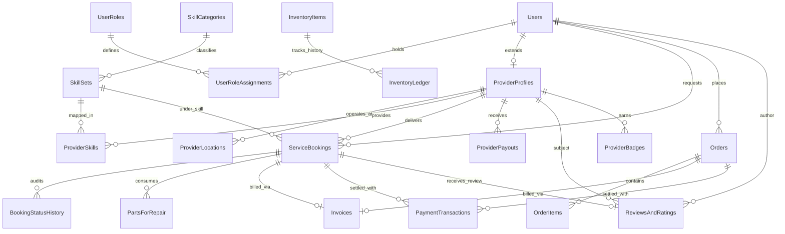
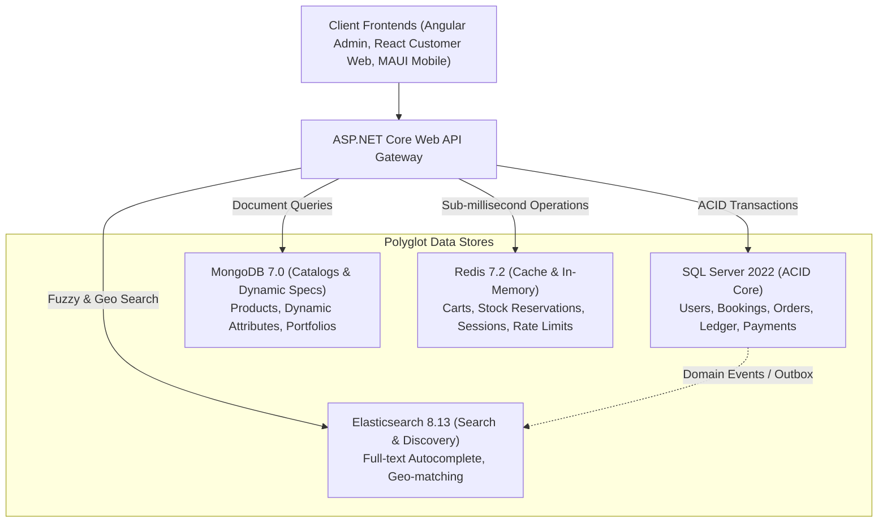

# SkillCommerce / Dokkho Lok Khuji (দক্ষ লোক খুঁজি)
## Database Architecture & Entity Relationship Diagrams

---

## 1. Relational Core Entity Relationship Diagram (SQL Server 3NF)

---

## 2. Polyglot Persistence Architecture & Data Flow

---

## 3. Polyglot Entity Reference Mapping

| Relational Table | Relational Column | Target Store | Target Collection / Key | Reference Type | Purpose |
| :--- | :--- | :--- | :--- | :--- | :--- |
| `OrderItems` | `MongoProductId` | **MongoDB** | `products._id` | Logical String ID | Immutable link to rich product attributes & catalog variants without cross-database FKs. |
| `PartsForRepair` | `MongoCatalogProductId` | **MongoDB** | `products._id` | Logical String ID | Identifies replacement parts pulled from physical warehouse catalog. |
| `InventoryItems` | `MongoProductId` | **MongoDB** | `products._id` | Logical String ID | Associates stock inventory ledger with MongoDB product catalog metadata. |
| `ProviderProfiles` | `ProfileId` | **MongoDB** | `provider_portfolios.providerId` | UUID String | Maps technician profile to rich media, certifications, and project portfolio. |
| `Orders` / `Cart` | `Sku` | **Redis** | `stock:available:{sku}` | String Key | Real-time atomic decrements and locks before committing to SQL Server ledger. |
| `ProviderLocations`| `Latitude, Longitude` | **Elasticsearch**| `providers_geo.location` | Geo Point | Index for fast bounding-box and Haversine geo-distance technician search. |
