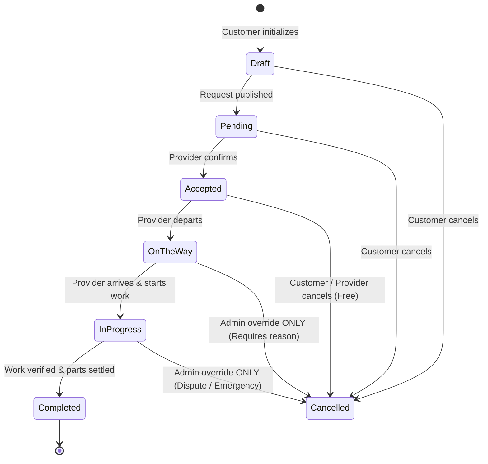

# SkillCommerce Web API Architecture & Implementation Guide

> **Document Type:** Consolidated Single Source of Truth for Web API & Backend Architecture  
> **Platform:** SkillCommerce / Dokkho Lok Khuji (দক্ষ লোক খুঁজি)  
> **Target Framework:** ASP.NET Core (.NET 9/10), C# 13/14, Entity Framework Core  
> **Status:** Canonical & Deduplicated Specification  

---

## 1. Architectural Paradigm & Clean Layer Invariants

The backend is built strictly using **Layered Clean Architecture**. Data flows unidirectionally inward toward the Domain model.

```text
SkillCommerce.Api  ──▶  SkillCommerce.Application  ──▶  SkillCommerce.Domain
       ▲                             ▲
       │                             │
       └─────── SkillCommerce.Infrastructure ─────────┘
```

### 1.1 Non-Negotiable Layer Boundaries
1. **Domain has zero external dependencies:** Contains pure entity models, value objects, domain events, and state machine enums. It references neither EF Core, nor ASP.NET Core, nor third-party utilities (with the sole exception of `NetTopologySuite` for spatial point definitions).
2. **Thin Controllers:** Controllers contain zero business logic, zero conditional checks on entity states, and zero direct database queries. A controller merely binds incoming HTTP payloads, extracts authenticated user claims, delegates to an Application service method, and returns an HTTP result.
3. **Application Layer Isolation:** Orchestrates business transactions, DTO mapping, and domain rules. It defines service and repository interfaces (`IRepository<T>`, `IUnitOfWork`) but never imports EF Core namespaces.
4. **Infrastructure Layer Concretion:** Houses EF Core `AppDbContext`, repository implementations, external payment gateways, JWT generation, and spatial database mappings.
5. **Entity Encapsulation:** All state transitions and updates occur via explicit entity domain methods (e.g., `booking.MarkAccepted()`, `booking.RecordArrival()`), never by external property assignment in services.

---

## 2. Technology Stack & Approved Package Registry

All libraries are managed centrally in `Directory.Packages.props`. Packages outside this approved registry may not be added:

| Category | Approved Library | Responsible Layer |
| :--- | :--- | :--- |
| **Framework** | `net9.0` / `net10.0` (LTS) | All |
| **Persistence & ORM** | `Microsoft.EntityFrameworkCore.SqlServer` | Infrastructure |
| **Spatial Engine** | `Microsoft.EntityFrameworkCore.SqlServer.NetTopologySuite` | Infrastructure, Domain |
| **Identity & Auth** | `Microsoft.AspNetCore.Identity.EntityFrameworkCore`, `Microsoft.AspNetCore.Authentication.JwtBearer` | Infrastructure, Api |
| **Validation** | `FluentValidation`, `FluentValidation.DependencyInjectionExtensions` | Application |
| **Object Mapping** | `Riok.Mapperly` (Compile-time Source Generated) | Application |
| **API Versioning** | `Asp.Versioning.Mvc`, `Asp.Versioning.Mvc.ApiExplorer` | Api |
| **Documentation** | `Microsoft.AspNetCore.OpenApi`, `Scalar.AspNetCore` | Api |
| **Logging** | `Serilog.AspNetCore` | Api |
| **Real-Time WebSockets**| ASP.NET Core SignalR (Built-in shared framework) | Api, Application |
| **Unit & Integration Tests** | `xunit.v3`, `NSubstitute`, `Shouldly`, `Testcontainers.MsSql` | Tests |

> **Prohibited Packages:** Do not install MediatR, AutoMapper, FluentAssertions 8+ (commercial licensing restrictions), Swashbuckle, Newtonsoft.Json, or in-memory EF providers.

---

## 3. Financial Calculation Engine & Non-Negotiable Invariants

All monetary figures represent Bangladeshi Taka (**BDT**), stored as `decimal(18,2)` in SQL Server, and rounded using `MidpointRounding.AwayFromZero`.

### 3.1 The Canonical Pricing Formula
$$\text{Total Charge} = \text{Labor Cost} + \text{Urgency Fee} + \text{Parts Total}$$
$$\text{Platform Commission Fee} = (\text{Labor Cost} + \text{Urgency Fee}) \times \text{Commission Rate}$$
$$\text{Provider Net Earnings} = \text{Total Charge} - \text{Platform Commission Fee} = \text{Parts Total} + [(\text{Labor Cost} + \text{Urgency Fee}) \times (1 - \text{Commission Rate})]$$

### 3.2 Non-Negotiable Financial Rules
1. **Zero Commission on Replacement Parts:** Hardware parts purchased by the technician to perform repairs have **strictly 0% platform commission**. The platform takes zero cut from physical materials.
2. **Urgency Fee Commissionability:** When a booking is marked `IsUrgent = true`, a flat fee (default `300.00 BDT`, read from `Pricing:UrgencyFee`) is added. Because urgency requires priority dispatch, this fee is grouped with labor and subject to the platform commission rate.
3. **Commission Snapshotting:** The default platform commission rate (default `10%` or `0.10`, read from `Pricing:CommissionRate`) is permanently copied onto the `ServiceBooking` entity at the instant of creation (`CommissionRateApplied`). Subsequent global config changes never alter historical bookings.
4. **Immutable Financial Ledger:** Once an invoice is issued and payment settled, financial rows are append-only. Hard deletion of invoices, ledger entries, or payment records is prohibited.

---

## 4. Booking State Machine & Invariant Transitions

Bookings follow a strictly guarded lifecycle state machine implemented in `BookingLifecycle.cs`:



### 4.1 Permitted Transitions & Actor Permissions
| Current State | Target State | Authorized Actor | Pre-Conditions & Domain Side Effects |
| :--- | :--- | :--- | :--- |
| `Draft` | `Pending` | Customer | Address and skill category selected. |
| `Pending` | `Accepted` | Provider | Provider matches category and service zone. Sets `AcceptedAtUtc`. |
| `Accepted` | `OnTheWay` | Provider | Sets `DispatchedAtUtc`. Real-time geolocation streaming begins. |
| `OnTheWay` | `InProgress` | Provider | Provider arrives on site. Sets `StartedAtUtc`. |
| `InProgress` | `Completed` | Provider / Customer | Work completed, replacement parts finalized. Sets `CompletedAtUtc` and issues invoice. |
| `Draft` / `Pending` | `Cancelled` | Customer | Instant cancellation. |
| `Accepted` | `Cancelled` | Customer / Provider | Free cancellation prior to provider dispatch. Sets `CancellationReason`. |
| `OnTheWay` / `InProgress` | `Cancelled` | **Admin Only** | Requires formal administrative intervention and logged justification. |

---

## 5. Real-Time SignalR Event Engine (`BookingHub`)

Real-time bidirectional synchronization is hosted at `/hubs/booking`.

### 5.1 Connection & Room Multiplexing
- Clients invoke `JoinBookingGroup(Guid bookingId)` upon mounting a booking tracker view.
- Clients invoke `LeaveBookingGroup(Guid bookingId)` when leaving the view.
- The server groups clients into room: `"booking-{bookingId}"`.

### 5.2 Server-to-Client Broadcast Events
```csharp
// 1. Status Change Notification
await Clients.Group($"booking-{bookingId}")
    .SendAsync("BookingStatusUpdated", bookingId, newStatus, updatedByRole, DateTime.UtcNow);

// 2. Geolocation Telemetry (when provider is OnTheWay)
await Clients.Group($"booking-{bookingId}")
    .SendAsync("ProviderLocationUpdated", bookingId, latitude, longitude, DateTime.UtcNow);
```

### 5.3 Cross-Client Parity Contract
- **React Portal:** Listens via `@microsoft/signalr` in `BookingTrackingModal.tsx`.
- **Angular Portal:** Listens in `provider-booking-detail.component.ts`.
- **Flutter / Dart Mobile:** Listens in `signalr_service.dart`.

---

## 6. API Conventions, Routing & Error Handling

### 6.1 Routing & Versioning Standard
- All controllers derive from `ControllerBase` and reside under `/api/v1/{controller}`.
- Example: `GET /api/v1/bookings/{id}`, `POST /api/v1/jobs/{id}/proposals`.

### 6.2 Idempotency Header
- Mutable endpoints (`POST /api/v1/bookings`, `POST /api/v1/payments/settle`) accept an optional header:
  `Idempotency-Key: <UUID>`
- The server records completed idempotency keys in Redis with a 24-hour TTL to prevent double-charging or duplicate bookings during network retries.

### 6.3 Standardized Error Responses (RFC 9457)
Errors return `application/problem+json` envelopes:
```json
{
  "type": "https://errors.skillcommerce.com/validation-error",
  "title": "One or more validation errors occurred.",
  "status": 400,
  "detail": "Invalid state transition from Completed to InProgress.",
  "instance": "/api/v1/bookings/3fa85f64-5717-4562-b3fc-2c963f66afa6/start",
  "errors": {
    "status": ["Cannot re-open a completed booking."]
  }
}
```

### 6.4 Safe JSON Serialization
Unstructured technical specifications and replacement parts items are validated against internal schemas and stored safely in SQL Server `nvarchar(max)` columns using `System.Text.Json` without binary type formatting vulnerabilities.

---

## 7. Identity, Authentication & Role Authorization

### 7.1 Cryptographic Password Security
- Passwords are validated using ASP.NET Core Identity's PBKDF2 with HMAC-SHA512 (minimum 100,000 iterations).

### 7.2 JWT Token Claims & Role Hierarchy
JWTs issued at `POST /api/v1/auth/login` include:
- `sub`: User unique identifier (`Guid`)
- `email`: User email address
- `role`: Role claim (`Customer`, `Provider`, or `Admin`)
- `profile_id`: Professional profile identifier (when `role == "Provider"`)

Endpoints enforce authorization via `[Authorize(Roles = "Provider,Admin")]`.

---

## 8. Geospatial Querying Standards

- **Coordinate System:** WGS84 standard (`EPSG:4326`).
- **Data Type:** SQL Server `geography` mapped to NetTopologySuite `Point(longitude, latitude)`.
- **Spatial Queries:** Executed using EF Core spatial extensions:
  ```csharp
  var nearbyProviders = await dbContext.ProfessionalProfiles
      .Where(p => p.IsVerified && p.IsAvailable &&
             p.Location.Distance(customerPoint) <= maxRadiusMeters)
      .OrderBy(p => p.Location.Distance(customerPoint))
      .ToListAsync(cancellationToken);
  ```

---

## 9. Comprehensive Endpoint Inventory

### Authentication & Profiles (`/api/v1/auth`, `/api/v1/profiles`)
- `POST /api/v1/auth/register` — Register customer or provider account.
- `POST /api/v1/auth/login` — Authenticate and receive JWT access token.
- `GET /api/v1/profiles/me` — Retrieve active authenticated user profile.
- `PUT /api/v1/profiles/provider` — Update provider trade skills, bio, and service radius.

### Skills & Taxonomy (`/api/v1/categories`, `/api/v1/skills`)
- `GET /api/v1/categories` — Retrieve all active trade categories (Electrician, Plumber, AC Tech, etc.).
- `GET /api/v1/categories/{id}/skills` — List certified granular skills under a category.

### Jobs & Proposals (`/api/v1/jobs`)
- `POST /api/v1/jobs` — Customer creates an open or direct request.
- `GET /api/v1/jobs/feed` — Available open jobs matching provider's trade skills and zone.
- `POST /api/v1/jobs/{id}/proposals` — Provider submits a fixed labor bid.
- `POST /api/v1/jobs/{id}/proposals/{bidId}/accept` — Customer accepts a bid, converting it to an active `ServiceBooking`.

### Bookings & Lifecycle (`/api/v1/bookings`)
- `GET /api/v1/bookings/{id}` — Retrieve full booking details, lifecycle timestamps, and pricing snapshot.
- `POST /api/v1/bookings/{id}/accept` — Provider accepts booking.
- `POST /api/v1/bookings/{id}/dispatch` — Provider departs for job (`OnTheWay`).
- `POST /api/v1/bookings/{id}/start` — Provider arrives and begins work (`InProgress`).
- `POST /api/v1/bookings/{id}/complete` — Provider completes work; generates invoice.
- `POST /api/v1/bookings/{id}/cancel` — Cancel booking with reason.

### Repair Parts & Invoicing (`/api/v1/bookings/{id}/parts`, `/api/v1/invoices`)
- `POST /api/v1/bookings/{id}/parts` — Record replacement hardware component used in repair.
- `DELETE /api/v1/bookings/{id}/parts/{partId}` — Remove itemized repair part before completion.
- `GET /api/v1/bookings/{id}/invoice` — Retrieve finalized itemized bill and commission calculation.

### Payments & Settlements (`/api/v1/payments`)
- `POST /api/v1/payments/settle` — Record settlement via Cash, bKash, Nagad, or Card.
- `POST /api/v1/payments/webhook/mock` — Mock payment gateway notification webhook.

### Reviews & Administrative Backoffice (`/api/v1/reviews`, `/api/v1/admin`)
- `POST /api/v1/reviews` — Submit verified review and 1-5 star rating for completed booking.
- `GET /api/v1/admin/verifications/pending` — Administrative queue of unverified provider applications.
- `POST /api/v1/admin/verifications/{id}/approve` — Admin approves provider NID and credentials.

