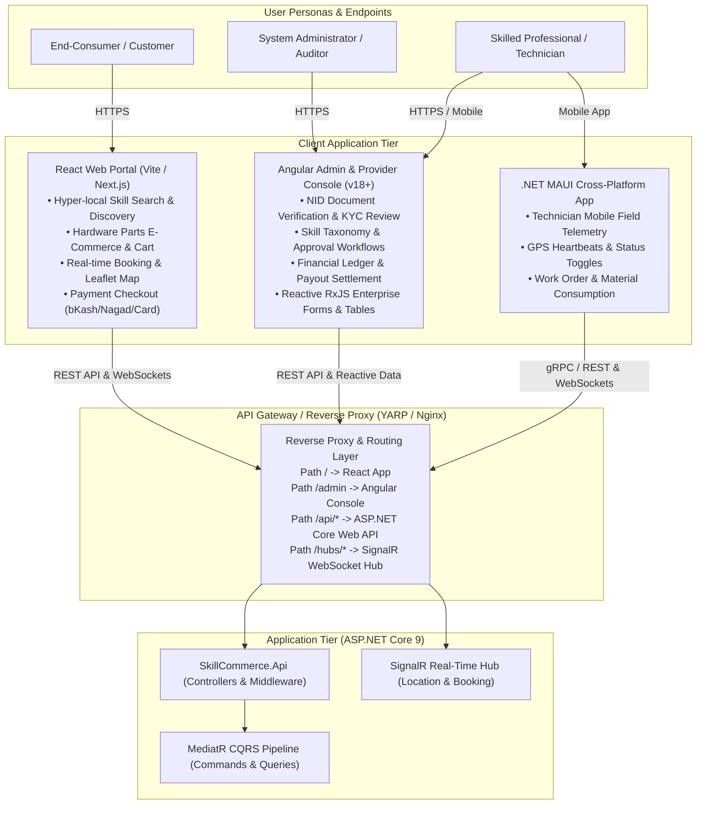
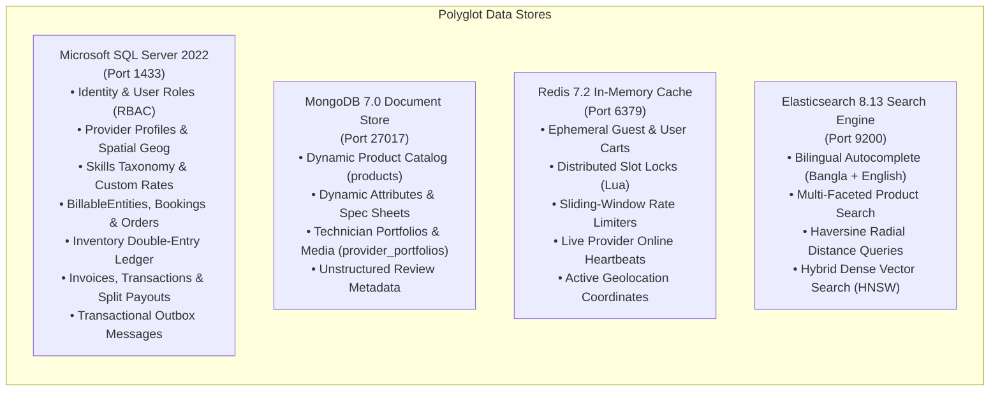

# SkillCommerce ("Dokkho Lok Khuji" / "Kaarigor")
# Comprehensive UML Modeling & System Architecture Instruction Guide

> **Target Audience:** Autonomous AI Coding Agents, Systems Architects, and Enterprise Software Engineers  
> **Target Output Location:** [`UML/`](file:///e:/Zafir_Hasan/Project_SkillCommerce/UML/) directory  
> **Standard:** Unified Modeling Language (UML 2.5) + Mermaid.js & PlantUML Specifications  
> **Project Identity:** SkillCommerce (*Dokkho Lok Khuji* / *Kaarigor*) — Hyper-Local On-Demand Skilled Service & Repair Marketplace with Integrated Physical Parts Catalog  
> **Lead Architect:** A.H.M. Zafir Hasan (IsDB-BISEW IT Scholarship Programme, Round 62)

---

## 📋 Table of Contents
1. [Operational Objectives & Scope of the UML Suite](#1-operational-objectives--scope-of-the-uml-suite)
2. [Project Vision, Goals & Business Domain Context](#2-project-vision-goals--business-domain-context)
3. [Dual-Frontend Hybrid Topology: React + Angular](#3-dual-frontend-hybrid-topology-react--angular)
4. [Polyglot Database Architecture & Storage Mapping](#4-polyglot-database-architecture--storage-mapping)
5. [Structural UML Model Specifications (Blueprints)](#5-structural-uml-model-specifications-blueprints)
   - 5.1 [Clean Architecture Package Diagram](#51-clean-architecture-package-diagram)
   - 5.2 [System Component Diagram (Hybrid Microfrontends & Polyglot Backing)](#52-system-component-diagram-hybrid-microfrontends--polyglot-backing)
   - 5.3 [Domain Class Diagram (Entity Framework Core & Domain Entities)](#53-domain-class-diagram-entity-framework-core--domain-entities)
   - 5.4 [Polyglot Data Model & Entity Relationship Diagram (SQL + Mongo + Redis + ES)](#54-polyglot-data-model--entity-relationship-diagram-sql--mongo--redis--es)
   - 5.5 [Physical Infrastructure & Deployment Diagram](#55-physical-infrastructure--deployment-diagram)
6. [Behavioral UML Model Specifications (Blueprints)](#6-behavioral-uml-model-specifications-blueprints)
   - 6.1 [Global Actor & Use Case Model](#61-global-actor--use-case-model)
   - 6.2 [Activity Diagrams (Multi-Actor Business Workflows)](#62-activity-diagrams-multi-actor-business-workflows)
     - 6.2.1 [Customer Discovery, Slot Locking & Booking Workflow](#621-customer-discovery-slot-locking--booking-workflow)
     - 6.2.2 [Professional Onboarding, Verification & KYC Workflow](#622-professional-onboarding-verification--kyc-workflow)
     - 6.2.3 [On-Site Diagnostics, Ad-Hoc Parts Quoting & Customer Approval](#623-on-site-diagnostics-ad-hoc-parts-quoting--customer-approval)
   - 6.3 [Sequence Diagrams (Inter-Service & Polyglot Synchronization)](#63-sequence-diagrams-inter-service--polyglot-synchronization)
     - 6.3.1 [Real-Time Slot Reservation with Redis Lua & SQL ACID Commit](#631-real-time-slot-reservation-with-redis-lua--sql-acid-commit)
     - 6.3.2 [Live GPS Technician Tracking via SignalR WebSockets](#632-live-gps-technician-tracking-via-signalr-websockets)
     - 6.3.3 [Transactional Outbox Pattern & CDC Dual-Stream Sync](#633-transactional-outbox-pattern--cdc-dual-stream-sync)
     - 6.3.4 [Financial Settlement & Commission Isolation Lifecycle](#634-financial-settlement--commission-isolation-lifecycle)
   - 6.4 [State Machine Diagrams](#64-state-machine-diagrams)
     - 6.4.1 [ServiceBooking State Machine](#641-servicebooking-state-machine)
     - 6.4.2 [ProviderProfile & Verification State Machine](#642-providerprofile--verification-state-machine)
     - 6.4.3 [BillableEntity & Invoice Settlement State Machine](#643-billableentity--invoice-settlement-state-machine)
7. [Step-by-Step Execution Runbook for the Modeling Agent](#7-step-by-step-execution-runbook-for-the-modeling-agent)
8. [Mermaid & PlantUML Syntax Validation Rules](#8-mermaid--plantuml-syntax-validation-rules)
9. [Final Deliverable Artifact Checklist](#9-final-deliverable-artifact-checklist)

---

## 1. Operational Objectives & Scope of the UML Suite

The primary objective of this instruction guide is to instruct an autonomous agent or software architect to construct a complete, professional, portfolio-grade UML 2.5 modeling suite for **SkillCommerce**.

The UML models must communicate three foundational pillars:
1. **The Project's Goal:** Demolish the informal, trust-deficient, price-obscure local services industry in Bangladesh by introducing verified skilled technicians, transparent hourly/fixed labor costing, real-time GPS tracking, and itemized physical parts costing.
2. **The Dual-Frontend Hybrid System Architecture:** Cleanly illustrate the co-existence and separation of concerns between:
   - **React (Customer Portal & Marketplace):** Fast, SEO-optimized, lightweight SPA/SSR for searching, booking, shopping for repair hardware, and customer checkout.
   - **Angular (Admin Console & Provider Back-Office):** Enterprise-grade, reactive, strict TypeScript/RxJS dashboard for KYC auditing, skill taxonomy management, commission accounting, and technician performance tracking.
   - **.NET MAUI (Technician Mobile Client):** Cross-platform field app for telemetry, work orders, and on-site parts addition.
3. **The Polyglot Database Architecture:** Detail how the transactional relational core (**Microsoft SQL Server 2022 3NF**), dynamic document store (**MongoDB 7.0**), in-memory cache and distributed lock engine (**Redis 7.2**), and spatial/hybrid search engine (**Elasticsearch 8.13**) operate harmoniously via the **Transactional Outbox Pattern** and **Change Data Capture (CDC)**.

---

## 2. Project Vision, Goals & Business Domain Context

### 2.1 The Problem Space
In Bangladesh and similar emerging economies, hiring electricians, AC mechanics, plumbers, appliance technicians, and carpenters relies on informal word-of-mouth or unvetted social media groups. Customers face:
- Unverified provider identities and safety hazards.
- Arbitrary pricing with hidden markups.
- Opaque costs when replacement components or spare parts are needed.
- No accountability, real-time arrival estimates, or structured warranties.

### 2.2 System Vision & Key Differentiators
SkillCommerce introduces an enterprise platform with:
- **Verified Technician Badges:** Multi-tier verification (National ID / NID card, trade license, technical certifications).
- **Separation of Labor & Materials Costing:** Work orders itemize both skilled labor and physical components.
- **Strict Commission Isolation:** Platform takes commission **only** from labor charges ($ \text{Commission} = \text{LaborAmount} \times \text{Rate} $). Physical hardware/materials bypass commissions completely, preventing providers from being penalized for purchasing expensive spare parts.
- **Spatial Geo-Matching:** Customers discover providers within a verified radial distance ($ \le \text{MaxRadiusKm} $) using `NetTopologySuite` spatial indexes in SQL Server and Haversine scoring in Elasticsearch.
- **Bi-Directional Telemetry:** Real-time en-route GPS tracking pushed via ASP.NET Core SignalR WebSockets.

---

## 3. Dual-Frontend Hybrid Topology: React + Angular

The project explicitly adopts a **Dual-Frontend Web Architecture** connected to a unified **ASP.NET Core 9 Web API** gateway. The modeling agent must represent this architecture accurately across Component, Package, and Deployment diagrams.



### 3.1 Frontend Responsibilities Breakdown
| Characteristic | Customer Portal (React) | Admin & Provider Console (Angular) | Technician Field App (.NET MAUI) |
| :--- | :--- | :--- | :--- |
| **Technology** | React 19, Vite, TailwindCSS / Vanilla CSS, Lucide | Angular 18+, TypeScript, Angular Material / Tailwind, RxJS | .NET 9 MAUI, C#, XAML, NetTopologySuite |
| **Primary Users** | Consumers, Homeowners, Commercial Clients | System Admins, KYC Auditors, Business Ops, Verified Providers | Field Technicians & Service Mistris |
| **Key Features** | Category browsing, live technician tracking, parts shopping cart, payment integration, reviews | KYC document verification, skill approval, ledger audit, commission payout batches, platform metrics | GPS background tracking, job acceptance, digital signature, on-site parts consumption entry |
| **State Management**| Zustand / TanStack Query | NgRx Store / RxJS BehaviorSubjects | MVVM (CommunityToolkit.Mvvm) |
| **API Transport** | Axios / Fetch (REST) + SignalR Client (WebSockets) | HttpClient with Interceptors (REST) + SignalR Client | Refit / HttpClient + SignalR Client |

---

## 4. Polyglot Database Architecture & Storage Mapping

The modeling agent must depict the **4 Polyglot Storage Engines** and their exact boundary responsibilities in both ERD and Component diagrams:



### 4.1 Cross-Store Entity Reference Matrix
The UML Class and ERD diagrams must reflect these cross-engine logical foreign keys:
- `PartsForRepair.MongoProductId` (SQL Server) $\rightarrow$ `products._id` (MongoDB): Immutable reference to catalog hardware without cross-database foreign key constraints.
- `PartsForRepair.SnapshotData` (SQL Server): Freezes the exact JSON specification, warranty details, and price snapshot at time of repair completion.
- `ProviderProfiles.ProfileId` (SQL Server) $\rightarrow$ `provider_portfolios.providerId` (MongoDB): Links the core relational provider entity to rich image galleries and certification scans.
- `ServiceBookings` (SQL Server) $\leftrightarrow$ `lock:provider:{id}:slot:{time}` (Redis): Distributed lock key preventing double-booking during checkout.
- `ProviderProfiles.BaseLocation` (SQL Server) $\leftrightarrow$ `provider_locations.location` (Elasticsearch): Spatial synchronization for fast neighborhood radius filtering.
- `OutboxMessages` (SQL Server) $\rightarrow$ Background Outbox Relay $\rightarrow$ Kafka Broker $\rightarrow$ Elasticsearch Indexers.

---

## 5. Structural UML Model Specifications (Blueprints)

The modeling agent must generate formal UML specifications for the following 5 Structural Diagrams:

### 5.1 Clean Architecture Package Diagram
- **Root Namespace:** `SkillCommerce`
- **Sub-Packages:**
  - `SkillCommerce.Domain`: Pure domain layer. Contains Entities (`ApplicationUser`, `ProviderProfile`, `SkillSet`, `ProviderSkill`, `ServiceBooking`, `BillableEntity`, `Order`, `PartForRepair`, `PaymentTransaction`, `Invoice`, `InventoryLedger`), Value Objects, Domain Events, Enums, and Repository Interfaces. Zero external dependencies.
  - `SkillCommerce.Application`: CQRS Handlers (MediatR), DTOs, FluentValidation rules, Mapping profiles (AutoMapper), Pipeline Behaviors (Logging, Validation, Transaction, Rate Limiting), and Service Interfaces.
  - `SkillCommerce.Infrastructure`: Data persistence implementations.
    - `Persistence.Sql`: `SkillCommerceDbContext` (EF Core 9), Migrations, Spatial Interceptors.
    - `Persistence.Mongo`: Mongo client wrappers, Catalog repositories.
    - `Persistence.Redis`: Connection multiplexer, Lua script runner, Distributed cache provider.
    - `Persistence.Elasticsearch`: Nest / Elastic.Clients, Search repositories.
    - `EventBus`: Kafka / RabbitMQ producer & consumer implementations.
    - `BackgroundJobs`: Hangfire workers, Outbox processor, cleanup crons.
  - `SkillCommerce.Api`: Presentation tier. ASP.NET Core 9 Controllers, Minimal APIs, SignalR Hubs (`LocationHub`, `BookingHub`), JWT middleware, Swagger/OpenAPI documentation.
  - `SkillCommerce.Clients`:
    - `SkillCommerce.Web.Customer` (React SPA)
    - `SkillCommerce.Web.Admin` (Angular SPA)
    - `SkillCommerce.Mobile.Technician` (.NET MAUI App)

### 5.2 System Component Diagram (Hybrid Microfrontends & Polyglot Backing)
- **Components to model:**
  - `[CustomerPortal (React Vite)]` with sub-components: `SearchWidget`, `ProviderCard`, `BookingCheckout`, `LiveTrackingMap`, `CartDrawer`.
  - `[AdminConsole (Angular 18)]` with sub-components: `VerificationReviewQueue`, `SkillTaxonomyManager`, `SettlementLedger`, `ProviderAuditGrid`.
  - `[TechnicianApp (.NET MAUI)]` with sub-components: `GpsTelemetryService`, `WorkOrderManager`, `PartsPicker`.
  - `[ReverseProxy (YARP / Gateway)]` routing traffic by URL path prefix.
  - `[CoreWebApi (.NET 9)]` hosting REST endpoints and SignalR Hubs.
  - `[OutboxRelayService (HostedService)]` executing CDC polling.
  - `[MessageBroker (Kafka)]` with topics: `booking-events`, `provider-location-updates`, `catalog-sync`.
  - `[Databases]`: `(SQL Server)`, `(MongoDB)`, `(Redis)`, `(Elasticsearch)`.

### 5.3 Domain Class Diagram (Entity Framework Core & Domain Entities)
The agent must generate an exhaustive UML Class Diagram showing all core entities, attributes, primary/foreign keys, and navigation properties:
1. `ApplicationUser` (`UserId`, `FullName`, `Email`, `PhoneNumber`, `IsVerified`, `CreatedAtUtc`)
2. `UserRole` (`RoleId`, `RoleName`, `Description`)
3. `UserRoleAssignment` (`UserId`, `RoleId`, `AssignedAtUtc`)
4. `ProviderProfile` (`ProfileId`, `UserId`, `NIDNumber`, `NIDDocumentUrl`, `Bio`, `ExperienceYears`, `OverallRating`, `Status`, `PayoutAccount`, `BaseLocation: Point`, `MaxRadiusKm`, `IsActive`)
5. `SkillCategory` (`CategoryId`, `CategoryName`, `IconUrl`, `Description`, `IsActive`)
6. `SkillSet` (`SkillId`, `CategoryId`, `SkillName`, `BasicPrice`, `ServiceUnit`, `IsUserGenerated`, `CreatedByUserId`, `IsApproved`)
7. `ProviderSkill` (`ProviderSkillId`, `ProfileId`, `SkillId`, `ExperienceYears`, `CustomRate`, `IsPrimary`, `PortfolioUrl`)
8. `BillableEntity` (`BillableEntityId: Guid`, `EntityType`, `CustomerId`, `CreatedAtUtc`)
9. `ServiceBooking` (`BookingId`, `BillableEntityId: Guid`, `CustomerId`, `ProfileId`, `SkillId`, `ServiceLocation: Point`, `ScheduledAt`, `Status`, `LaborAmount`, `PlatformFee`, `MaterialsAmount`, `TotalAmount: Computed`)
10. `BookingStatusHistory` (`HistoryId`, `BookingId`, `Status`, `ChangedByUserId`, `Notes`, `ChangedAtUtc`)
11. `PartForRepair` (`PartItemId`, `BookingId`, `MongoProductId`, `ItemDescription`, `Quantity`, `UnitPrice`, `LineTotal: Computed`, `CustomerApproved`, `SnapshotData`)
12. `PaymentTransaction` (`TransactionId`, `BillableEntityId: Guid`, `Amount`, `TransactionType`, `PaymentMethod`, `GatewayReference`, `Status`)
13. `Invoice` (`InvoiceId`, `BillableEntityId: Guid`, `InvoiceNumber`, `SubTotal`, `PlatformCommission`, `TotalPayable`, `PaidStatus`, `IssuedAtUtc`)
14. `ReviewAndRating` (`ReviewId`, `BookingId`, `CustomerId`, `ProfileId`, `Rating: 1..5`, `Comment`, `CreatedAtUtc`)
15. `OutboxMessage` (`Id: Guid`, `AggregateType`, `AggregateId`, `Type`, `Payload`, `CreatedAtUtc`, `ProcessedAtUtc`, `Error`)

### 5.4 Polyglot Data Model & Entity Relationship Diagram (SQL + Mongo + Redis + ES)
The agent must generate a composite ERD / Data Model showing:
- 3NF Relational Tables with exact primary and foreign key constraints.
- MongoDB Collections (`products`, `provider_portfolios`, `reviews`) with JSON Schema validation types.
- Redis In-Memory Structures (`Hash`, `String`, `ZSet`, `GeoSet`) with key patterns and TTL policies.
- Elasticsearch Document Mappings (`catalog_products`, `provider_locations`) with field analyzers, `geo_point`, and `dense_vector`.

### 5.5 Physical Infrastructure & Deployment Diagram
- **Target Deployment Platform:** Dockerized Multi-Container Environment / Kubernetes Cluster.
- **Nodes & Containers:**
  - `Client Workstation`: React Web Application running inside Chrome/Firefox/Edge.
  - `Admin Workstation`: Angular Web Application running inside Enterprise Browser.
  - `Mobile Device (Android / iOS)`: .NET MAUI Native Application with GPS Hardware Access.
  - `Container Host (Docker Engine)`:
    - Container `skillcommerce-webapi` (Port `5000:8080`, ASP.NET Core 9).
    - Container `skillcommerce-sqlserver` (Port `1433`, MS SQL Server 2022 CU12, Volume mounted).
    - Container `skillcommerce-mongodb` (Port `27017`, MongoDB 7.0 with replica set for Change Streams).
    - Container `skillcommerce-redis` (Port `6379`, Redis 7.2 with AOF persistence).
    - Container `skillcommerce-elasticsearch` (Port `9200`, Elasticsearch 8.13 with 1GB JVM).
    - Container `skillcommerce-kafka` (Port `9092`, Kafka KRaft mode).
    - Container `skillcommerce-outbox-worker` (Background daemon container).

---

## 6. Behavioral UML Model Specifications (Blueprints)

The modeling agent must generate formal specifications for the following Behavioral Diagrams:

### 6.1 Global Actor & Use Case Model
- **Primary Actors:**
  - `Customer (Consumer)`: Registers, searches skills by location, locks slot, books appointment, tracks technician live, approves extra parts, pays invoice, posts review.
  - `Professional (Provider/Mistri)`: Submits NID and certificates, registers custom skills and rates, toggles daily availability, accepts/rejects bookings, shares live GPS, adds parts on-site, receives payout.
  - `Administrator (SuperAdmin / Auditor)`: Audits provider NIDs, approves/rejects profiles, moderates custom skills, oversees platform ledger, configures commission rates.
  - `Background Outbox Worker (System)`: Polls outbox table, emits domain events to Kafka, indexes provider coordinates and products in Elasticsearch, cleans expired locks.

### 6.2 Activity Diagrams (Multi-Actor Business Workflows)

#### 6.2.1 Customer Discovery, Slot Locking & Booking Workflow
- **Swimlanes:** `Customer (React UI)`, `API Gateway (.NET 9)`, `Redis Cache`, `SQL Server 2022`, `Provider (.NET MAUI)`.
- **Flow:**
  1. Customer searches "AC Repair" in Dhaka (Mirpur).
  2. Elasticsearch returns filtered providers sorted by distance ($ \le 10 \text{ km} $) and rating.
  3. Customer selects Provider and clicks a time slot.
  4. Web API runs atomic Lua script `reserve_stock.lua` on Redis key `lock:provider:{id}:slot:{time}` (TTL: 10 mins).
  5. If lock fails $\rightarrow$ Prompt customer to pick another slot.
  6. If lock succeeds $\rightarrow$ Customer confirms booking.
  7. API initiates SQL transaction: Creates `BillableEntity`, inserts `ServiceBooking` (`Status = 'Pending'`), writes `OutboxMessage` (`BookingCreated`), commits transaction.
  8. Provider receives push notification on MAUI app via SignalR.

#### 6.2.2 Professional Onboarding, Verification & KYC Workflow
- **Swimlanes:** `Provider (Angular / Web)`, `Admin Auditor (Angular Console)`, `Verification Service (.NET 9)`, `Document Storage (Mongo/Blob)`, `SQL Server 2022`.
- **Flow:**
  1. Provider registers user account and selects "Become a Provider".
  2. Enters NID number, phone, base coordinates, service radius, and skill catalog.
  3. Uploads scanned NID and trade license images.
  4. System inserts `ProviderProfile` with `Status = 'Pending'`, `IsActive = 0`.
  5. Audit task appears on Admin's Angular Console queue.
  6. Admin inspects NID scans against official database.
  7. Admin decision:
     - If rejected: Admin enters rejection remarks $\rightarrow$ Notification sent to provider $\rightarrow$ Account remains inactive.
     - If approved: Admin clicks "Approve" $\rightarrow$ Profile status updated to `'Approved'` in SQL Server $\rightarrow$ Outbox event dispatched $\rightarrow$ Provider coordinates indexed in Elasticsearch.
  8. Provider toggles `IsActive = 1` $\rightarrow$ Profile is now eligible for customer booking dispatches.

#### 6.2.3 On-Site Diagnostics, Ad-Hoc Parts Quoting & Customer Approval
- **Swimlanes:** `Technician (MAUI App)`, `Core Web API`, `Customer (React Web App)`, `SQL Server 2022`.
- **Flow:**
  1. Technician arrives on-site (`Status = 'Arrived'`) and inspects appliance.
  2. Technician identifies burnt capacitor. Opens MAUI app and searches catalog or enters ad-hoc part"../UML": *"SHIZUKI 45uF Capacitor - 650 BDT"*.
  3. MAUI submits `AddPartToBookingCommand` with `CustomerApproved = 0`.
  4. SQL Server stores record in `PartsForRepair`.
  5. Real-time SignalR push alerts Customer's React app with a modal: *"Technician has requested 1 replacement part totaling 650 BDT. Do you approve?"*
  6. Customer options:
     - Reject $\rightarrow$ Part flagged as rejected; technician notified not to install.
     - Approve $\rightarrow$ Customer enters OTP or clicks Approve $\rightarrow$ API updates `CustomerApproved = 1` and freezes JSON snapshot into `PartsForRepair.SnapshotData`.
  7. Service finishes $\rightarrow$ Final invoice generated with labor + approved parts.

### 6.3 Sequence Diagrams (Inter-Service & Polyglot Synchronization)

#### 6.3.1 Real-Time Slot Reservation with Redis Lua & SQL ACID Commit
- **Participants:** `ReactCustomerPortal`, `BookingsController`, `RedisCacheService`, `LuaScriptEngine`, `SkillCommerceDbContext`, `SqlServerCore`.
- Illustrate the exact 2-phase concurrency check: Redis distributed lock first, followed by ACID transactional insert into `BillableEntities`, `ServiceBookings`, and `OutboxMessages`.

#### 6.3.2 Live GPS Technician Tracking via SignalR WebSockets
- **Participants:** `MauiTechnicianApp`, `LocationHub (SignalR)`, `RedisGeoStore`, `ReactCustomerPortal`.
- Illustrate the high-frequency telemetry loop:
  1. MAUI app tracks GPS coordinates every 5 seconds.
  2. MAUI invokes `LocationHub.SendLocationUpdate(bookingId, lat, lng)`.
  3. Hub updates Redis key `geo:providers:active`.
  4. Hub broadcasts event `ReceiveTechnicianLocation(lat, lng)` to the specific Customer connection group.
  5. React portal's Leaflet/Mapbox component smoothly interpolates the technician's marker on screen.

#### 6.3.3 Transactional Outbox Pattern & CDC Dual-Stream Sync
- **Participants:** `DomainService`, `SqlServerLocalTx`, `OutboxTable`, `OutboxRelayWorker (Hangfire)`, `KafkaBroker`, `ElasticsearchConsumer`, `ElasticsearchCluster`.
- Illustrate:
  1. Local transaction commits domain entities and `OutboxMessage` in one atomic round-trip.
  2. `OutboxRelayWorker` polls pending outbox messages (`ProcessedAtUtc IS NULL`).
  3. Worker publishes message to Kafka topic `provider-events`.
  4. Worker marks outbox row as `ProcessedAtUtc = SYSUTCDATETIME()`.
  5. Kafka consumer receives message, transforms entity into geo-point JSON, and indexes into Elasticsearch `provider_locations`.

#### 6.3.4 Financial Settlement & Commission Isolation Lifecycle
- **Participants:** `Technician`, `Customer`, `BillingService`, `PaymentGateway (bKash/Nagad)`, `InvoicesTable`, `ProviderPayoutsTable`.
- Highlight the mathematical formula:
  $$\text{LaborAmount} = 1000 \text{ BDT}, \quad \text{MaterialsAmount} = 650 \text{ BDT}$$
  $$\text{PlatformFee} = 1000 \times 15\% = 150 \text{ BDT}$$
  $$\text{Provider Net Payout} = (1000 - 150) + 650 = 1500 \text{ BDT}$$
  $$\text{Total Customer Paid} = 1000 + 650 = 1650 \text{ BDT}$$

### 6.4 State Machine Diagrams
The modeling agent must model the exact state lifecycles with transitions, trigger events, guards, and actions:
1. **`ServiceBooking` Lifecycle:**
   - States: `Requested (Pending)`, `Cancelled`, `Accepted`, `OnTheWay`, `Arrived`, `InProgress`, `Completed`.
   - Guards: Cannot cancel without penalty after `OnTheWay`. Cannot mark `Completed` without all added parts being approved or discarded.
2. **`ProviderProfile` Lifecycle:**
   - States: `Draft`, `Pending (Awaiting KYC)`, `Rejected`, `Approved`, `Suspended`, `Deactivated`.
   - Sub-State: When `Approved`, availability toggles between `Active (Online)` and `Inactive (Offline)`.
3. **`BillableEntity` / `Invoice` Lifecycle:**
   - States: `Created (Draft)`, `PendingPayment`, `PartiallyPaid (Labor Deposit)`, `PaidInFull`, `Refunded`.

---

## 7. Step-by-Step Execution Runbook for the Modeling Agent

When tasked with generating the actual UML diagrams, the agent must execute the following sequential steps:

### Phase 1: Structure the Output Directory
The agent must verify or create the target directory structure inside [`UML/`](file:///e:/Zafir_Hasan/Project_SkillCommerce/UML/):
```text
UML/
├── UML_Design_Instruction_Guide.md     # (This master instruction guide)
├── 01_System_Architecture_and_Goals.md # Project Vision, Scope, Actor Model & Component Topology
├── 02_Structural_Class_and_Package.md  # Clean Architecture Package, EF Core Domain Class Diagrams
├── 03_Polyglot_Database_and_ERD.md     # 3NF SQL Server ERD, Mongo Schemas, Redis Registry, ES Mappings
├── 04_Behavioral_Workflows_Activity.md # Customer, Provider KYC, and Dynamic Parts Activity Diagrams
├── 05_Sequence_and_Realtime_Flows.md   # Redis Lua, SignalR Telemetry, Outbox CDC, Split Settlement
├── 06_State_Machine_Lifecycles.md      # Booking, Provider Profile, and Invoice State Machines
└── 07_Physical_Deployment_Diagram.md   # Container Topology, Network Ports, Protocols & Security
```

### Phase 2: Generate Each File with Complete Mermaid Code Blocks
For each topic, the agent must write:
1. Clear textual explanation of the architectural rationale and business constraints.
2. Production-grade **Mermaid.js** code block (using `classDiagram`, `componentDiagram` / `flowchart TD`, `erDiagram`, `sequenceDiagram`, `stateDiagram-v2`).
3. An entity dictionary or interaction table explaining every node, relationship, and method.

### Phase 3: Validate Syntax and Rendering
The agent must review the generated Mermaid blocks against the syntax rules in Section 8 to ensure zero syntax or parser errors.

---

## 8. Mermaid & PlantUML Syntax Validation Rules

To prevent broken diagram rendering in GitHub, Antigravity IDE, and documentation viewers, the modeling agent must adhere strictly to these rules:

1. **Quote Node Labels with Special Characters:**
   - ❌ `SQL_Core[ACID Tables (SQL Server)]`
   - ✅ `SQL_Core["ACID Tables (SQL Server)"]`
2. **Avoid HTML Tags Inside Node Labels:**
   - ❌ `Node["Title<br>Subtitle"]` (May fail in strict SVG engines)
   - ✅ Use standard quotes with sanitized `<br/>` or clean multi-line labels.
3. **Mermaid Class Diagram Rules:**
   - Always define visibility symbols: `+` (public), `-` (private), `#` (protected).
   - Use correct relationship syntax:
     - Inheritance: `--|>`
     - Realization / Interface: `..|>`
     - Composition: `*--`
     - Aggregation: `o--`
     - Association: `-->`
4. **Mermaid Sequence Diagram Rules:**
   - Always declare `autonumber` at the top of sequence blocks.
   - Use `activate` and `deactivate` explicitly to show activation bars.
   - Use `critical`, `opt`, `alt`, and `par` blocks to represent conditional and parallel processing.
5. **Mermaid ERD Rules:**
   - Use valid cardinality symbols:
     - `||--||` (Exactly one to exactly one)
     - `||--o{` (One to zero-or-more)
     - `||--|{` (One to one-or-more)
     - `}|--o{` (Many to zero-or-more)
   - Enclose attribute types in valid single-word strings (e.g., `INT`, `NVARCHAR`, `DECIMAL`, `GEOGRAPHY`, `DATETIME2`).

---

## 9. Final Deliverable Artifact Checklist

Before considering the UML modeling task complete, the agent must verify the presence of all items in this checklist:

- [ ] **Project Goal & Context Defined:** Academic capstone context, Bangladesh local market problem statement, and key differentiators clearly documented.
- [ ] **Dual-Frontend Architecture Documented:** Explicit separation and interaction between React (Customer Portal) and Angular (Admin & Provider Portal) modeled across components and gateways.
- [ ] **All 4 Polyglot Stores Covered:** SQL Server (3NF), MongoDB (Catalogs), Redis (Locks/Carts), and Elasticsearch (Search/Vectors) represented with logical linkages.
- [ ] **5 Structural Diagrams Implemented:**
  - [ ] Clean Architecture Package Diagram
  - [ ] System Component Diagram
  - [ ] Domain Model Class Diagram
  - [ ] Polyglot ERD / Data Model Diagram
  - [ ] Physical Infrastructure / Deployment Diagram
- [ ] **7 Behavioral Diagrams Implemented:**
  - [ ] Actor & Global Use Case Diagram
  - [ ] Customer Booking Activity Diagram
  - [ ] Provider KYC & Verification Activity Diagram
  - [ ] Dynamic Parts Quoting & Customer Approval Activity Diagram
  - [ ] Real-Time Slot Locking & Booking Sequence Diagram
  - [ ] SignalR Live GPS Telemetry Sequence Diagram
  - [ ] Transactional Outbox CDC Sequence Diagram
  - [ ] Financial Settlement & Split Commission Sequence Diagram
- [ ] **3 State Machine Diagrams Implemented:**
  - [ ] `ServiceBooking` State Machine
  - [ ] `ProviderProfile` State Machine
  - [ ] `BillableEntity` / `Invoice` State Machine
- [ ] **Clean Markdown Formatting:** All files saved in [`UML/`](file:///e:/Zafir_Hasan/Project_SkillCommerce/UML/) with clickable links, proper alerts, and valid Mermaid diagrams.
