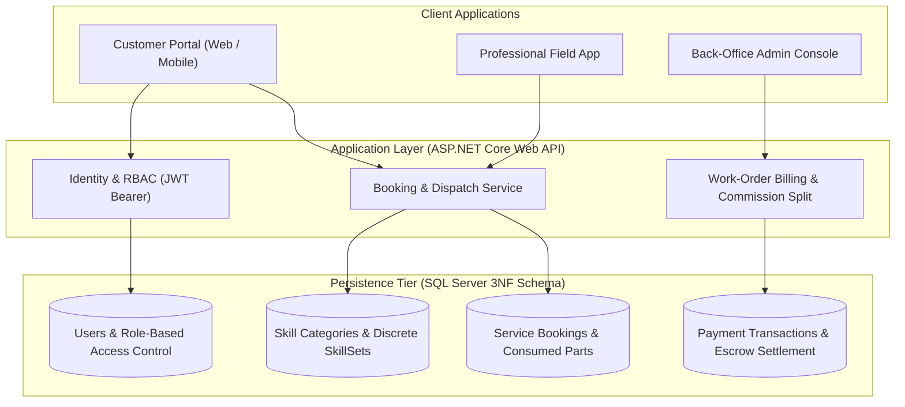
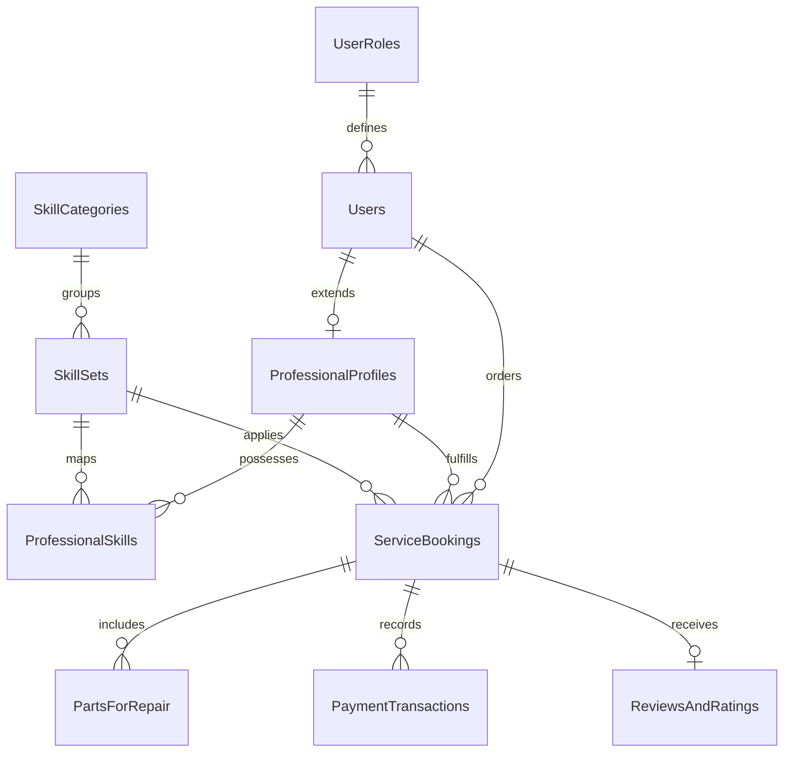

# Skill-Commerce — Hyperlocal On-Demand Skilled Services Platform

[](https://www.microsoft.com/sql-server)
[](docs/DATABASE_ARCHITECTURE_SPEC.md)
[](LICENSE)

An enterprise-grade **Hyperlocal Skilled-Worker & Technical Services Marketplace** architecture connecting vetted professionals with consumers for on-demand technical diagnostics, hardware repair, electrical, and appliance installations.

Developed as the **Capstone Engineering Project** under the **IsDB-BISEW IT Scholarship Programme**, with **A.H.M. Zafir Hasan** serving as the **Backend and Database Architecture Lead**.

---

## 🏛 System Architecture Overview



---

## 🌟 Database Lead Key Contributions (A.H.M. Zafir Hasan)

1. **Third Normal Form (3NF) Relational Architecture:**
   - Designed 9 fully normalized relational tables eliminating data anomalies and redundant storage.
   - Decoupled skill taxonomy into `SkillCategories` and `SkillSets`.
   - Engineered junction table `ProfessionalSkills` with composite uniqueness constraints to enable multi-disciplinary technicians.

2. **Combined Labor & Parts Costing Engine:**
   - Developed the relational model for `ServiceBookings` connected to child entity `PartsForRepair`.
   - Included computed columns (`[Quantity] * [UnitPrice]`) and warranty tracking per physical part replaced.

3. **Multi-Party Financial Split Auditing:**
   - Designed `PaymentTransactions` to maintain complete auditability for gross customer payments, automated platform service fees, and net professional payouts.

4. **Performance & Integrity Guardrails:**
   - Implemented non-clustered indexing across foreign keys, normalized emails, and booking statuses.
   - Enforced referential cascading integrity and check constraints (`Rating BETWEEN 1 AND 5`).

---

## 🗄 Entity-Relationship Diagram



---

## 📂 Repository Contents

```
Skill-Based_E-Commerce_Platform-Project/
├── Database/
│   └── SkillCommerce_Schema_and_Seed.sql     # Complete T-SQL DDL & Seed Data Script
├── docs/
│   └── DATABASE_ARCHITECTURE_SPEC.md         # 3NF Normalization Analysis & Field Spec
├── .gitignore                                 # Hardened Git exclusions
└── README.md                                  # Executive Capstone Documentation
```

---

## 🚀 Setting Up the Database

### Prerequisites
- Microsoft SQL Server 2019+ or LocalDB
- SQL Server Management Studio (SSMS), Azure Data Studio, or `sqlcmd`

### Execute Script
```bash
sqlcmd -S "(localdb)\MSSQLLocalDB" -i Database/SkillCommerce_Schema_and_Seed.sql
```

---

## 👤 Author & Academic Background

- **Database & Backend Lead:** A.H.M. Zafir Hasan
- **Scholarship:** IsDB-BISEW IT Scholarship Programme (Round 62 / Enterprise Systems)
- **GitHub:** [@Zafff-e](https://github.com/Zafff-e)
