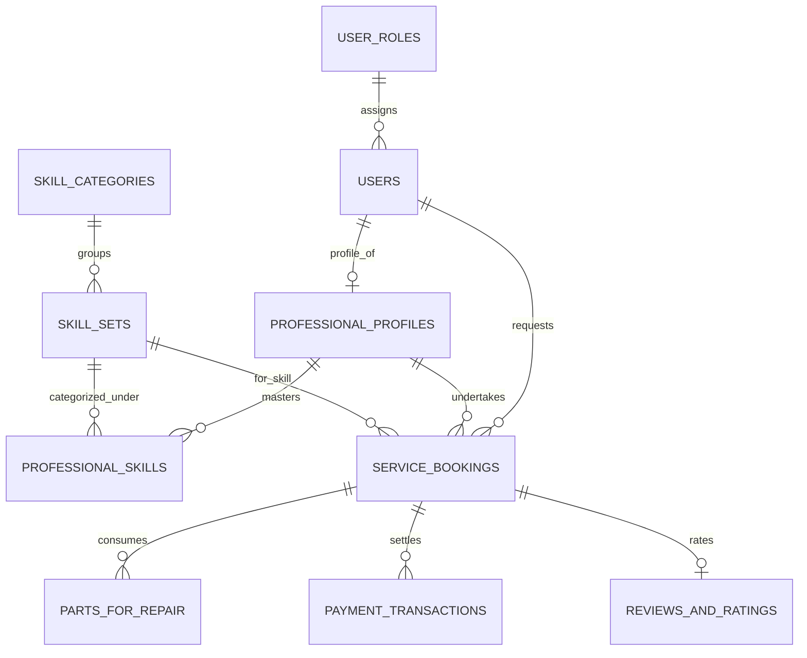

# Skill-Commerce Architecture Specification & 3NF Data Model

**Project:** Skill-Commerce Hyperlocal Skilled-Worker Marketplace  
**Lead Author / Role:** A.H.M. Zafir Hasan (Backend & Database Architecture Lead)  
**Affiliation:** IsDB-BISEW IT Scholarship Programme (Round 62 / Enterprise Capstone)  

---

## 1. System Vision & Problem Statement

Traditional gig marketplaces often lack granular technical skill classification, integrated replacement part costing, and verified identity controls for physical trade professionals (electricians, IT technicians, appliance engineers).

**Skill-Commerce** bridges this gap by providing:
1. **Hierarchical Skill Taxonomy:** High-level trade domains mapped to discrete certified skill competencies.
2. **Atomic Work Order Management:** Combined billing accommodating hourly labor rates plus itemized replacement hardware components.
3. **Escrow Commission Settlement:** Transparent split accounting tracking gross customer charge, platform fee, and technician net payout.

---

## 2. Third Normal Form (3NF) Normalization Rationale

The database strictly conforms to **3NF**:
- **1NF Compliance:** Every attribute contains atomic values; repeating groups (such as skills possessed or repair parts used) are decomposed into normalized dependent tables.
- **2NF Compliance:** All non-key attributes are fully functionally dependent on the entire primary key.
- **3NF Compliance:** Non-key attributes depend only on the primary key, eliminating transitive dependencies. For example, `SkillCategories` exists independently from `SkillSets`, preventing anomalous updates to category metadata when skills are modified.

---

## 3. Entity-Relationship Model (Mermaid ERD)

